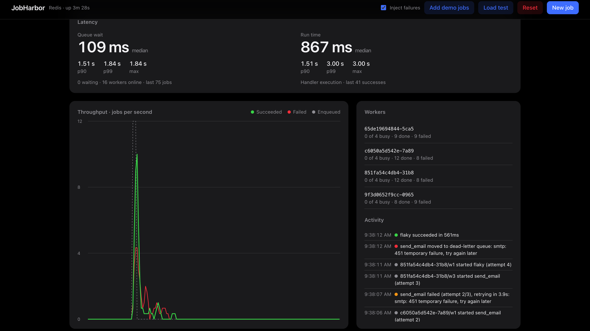
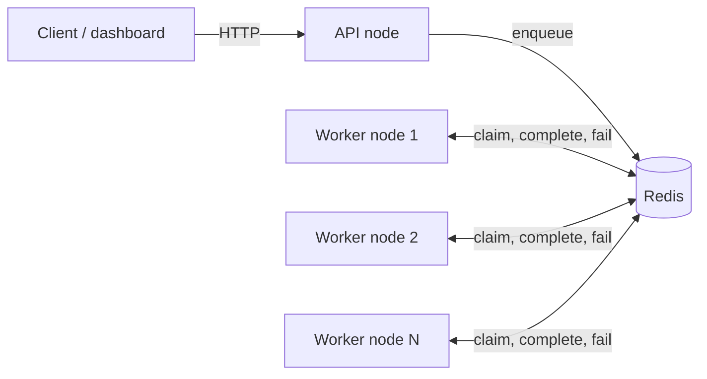

# JobHarbor

A distributed background job queue in Go, backed by Redis, with a live dashboard.
Workers on any number of machines pull from one shared queue. Jobs are claimed atomically, retried with exponential backoff, and moved to a dead-letter queue when they cannot succeed. Jobs held by crashed workers are recovered automatically.

JobHarbor includes priorities, scheduling, a dead-letter queue, crash recovery, multi-node workers, latency percentiles, Prometheus metrics and a web UI.



## Run it

**Embedded mode (nothing to install except Go 1.22+)**
```bash
go mod tidy
go run ./cmd/jobharbor            # in-memory Redis inside the process
JH_WORKERS=32 go run ./cmd/jobharbor
```
Open http://localhost:8080 and use **Add demo jobs** or **Load test**. Jobs are lost on exit.

**Real Redis, multiple worker nodes (Docker)**
```bash
docker compose up --build --scale worker=4
```
This starts one API and dashboard container, four worker containers (4 goroutine workers each) and a Redis server with persistence. The header reads "Redis" (not "Embedded Redis") and the Workers panel lists four nodes.

**Real Redis without Docker**
```bash
redis-server &
JH_REDIS=localhost:6379 JH_MODE=api go run ./cmd/jobharbor
JH_REDIS=localhost:6379 JH_MODE=worker JH_WORKERS=4 go run ./cmd/jobharbor   # repeat for more nodes
```

Tests: `go test -race ./...`

## Measured results

All numbers come from the dashboard on a laptop, with simulated handlers (they sleep 0.3 to 4 s instead of doing real work) and the **Inject failures** option on, so about 20% of jobs fail on purpose to exercise retries and the dead-letter queue. Queue wait is the time from a job becoming ready to a worker starting it. Run time is handler execution time. Percentiles are nearest-rank over the last 2000 samples.

| | Embedded Redis, 32 workers | Embedded Redis, 32 workers | Real Redis, 4 containers x 4 workers |
|---|---|---|---|
| Load | 1,200 jobs, two bursts of about 20 jobs/s | 100 jobs, two 50-job bursts | 50 jobs in one burst |
| Succeeded / dead-letter | 981 / 219 | 78 / 22 | 41 / 9 |
| Retries | 496 | 54 | 25 |
| Success rate | 82% | 78% | 82% |
| Queue wait p50 | 188 ms | 144 ms | 109 ms |
| Queue wait p90 | 1.73 s | 631 ms | 1.51 s |
| Queue wait p99 | 18.3 s | 904 ms | 1.84 s |
| Queue wait max | 20.0 s | 905 ms | 1.84 s |
| Run time p50 / p90 / p99 | 938 ms / 2.10 s / 4.00 s | 908 ms / 3.00 s / 4.00 s | 867 ms / 1.51 s / 3.00 s |
| Backlog at end | 0 | 0 | 0 |

An overload case, to show what saturation looks like: with **4 workers** in one process and repeated load tests of about 20 jobs/s, queue wait p50 reached **77 s** (p90 140 s, p99 150 s) with 260 jobs waiting. Four workers clear roughly 3 jobs/s when the average job takes 1.2 s, so a 20 jobs/s arrival rate builds a backlog. Rerunning with 32 workers brought median queue wait back to about 190 ms.

### How to read these numbers
- **Median queue wait is 100 to 190 ms** whenever workers are not saturated. Idle workers poll every 120 to 220 ms, so that is close to the floor.
- **The tail is driven by load, not by the queue itself.** The 18 s p99 in the first column came during bursts where arrivals plus retries briefly exceeded what 32 workers could clear. Capacity needed is roughly the arrival rate times the average run time.
- **Run time is simulated** by the demo handlers, so it only shows that the timing is measured correctly.
- **Real Redis was tested with a small sample (50 jobs)**, so its p99 is not a stable figure. Embedded and real-Redis results are not a like-for-like performance comparison: the runs used different worker counts and loads.
- Not yet measured: a failure-free load run, and the crash-recovery timing. See "Crash recovery demo" below to reproduce the latter.

## How it works



| Key | Type | Purpose |
|---|---|---|
| `jh:jobs` | hash | job id to JSON record |
| `jh:ready` | sorted set | score = `(2 - priority) * 1e13 + enqueue_ms`, so the lowest score is the best job |
| `jh:delayed` | sorted set | scheduled jobs and retries waiting out their backoff, score = run time |
| `jh:running` | sorted set | claimed jobs, score = lease expiry |
| `jh:dead` | sorted set | dead-letter queue |
| `jh:idem` | hash | idempotency key to job id |
| `jh:lat:wait`, `jh:lat:run` | lists | recent latency samples |
| `jh:stats`, `jh:nodes`, `jh:events` | hash / hash / list | counters, worker heartbeats, activity feed |

- **Atomic claim.** A Lua script pops the best ready job and adds it to the running set with a lease, so two nodes can never take the same job.
- **Retries.** A failed job goes to the delayed set with `base * 2^attempt` backoff (2 s base, 60 s cap, plus or minus 20% jitter). A Lua script promotes due jobs to the ready set.
- **Dead-letter queue.** Jobs go there after exhausting retries or when a handler returns `queue.Permanent(err)`. They can be retried from the UI or API.
- **Crash recovery.** Every claim carries a 45 s lease. A reaper on every worker node re-queues jobs whose lease expired.
- **Idempotency.** `HSETNX` on the idempotency key makes duplicate enqueues return the original job.
- **Graceful shutdown.** On SIGTERM workers stop claiming and finish in-flight jobs.
- **Safety.** Per-job timeout of 30 s, handler panics become failed attempts, webhook jobs refuse private and loopback addresses, and writes require `X-API-Key` when `JH_API_KEY` is set.

Delivery is **at-least-once**. A job whose worker dies is retried after the lease expires, so handlers should be idempotent.

## Crash recovery demo
1. Start the Docker setup and untick **Inject failures**.
2. Click **Load test**.
3. In another terminal run `docker kill jobharbor-worker-1`.
4. The node should disappear from the Workers panel within about 8 s. After the lease expires (up to 45 s), Activity shows `lease expired: worker crashed or timed out` for its in-flight jobs, and the other nodes finish them.

## API
```bash
curl -X POST localhost:8080/api/jobs -d '{"type":"send_email","payload":{"to":"a@b.com"},"priority":"high","max_retries":3,"idempotency_key":"order-42"}'
curl 'localhost:8080/api/jobs?status=dead'
curl -X POST   localhost:8080/api/jobs/<id>/retry
curl -X DELETE localhost:8080/api/jobs/<id>          # cancel before it starts
curl -X POST localhost:8080/api/demo -d '{"count":400,"spread_seconds":20,"clean":true}'
curl localhost:8080/api/stats
curl localhost:8080/metrics                          # Prometheus text format
```
Job types: `send_email`, `resize_image`, `generate_pdf`, `webhook`, `flaky`, `sleep`. To add one, register a function in `internal/worker/handlers.go`. The original WorkQueue `retries` field is accepted too.

Metrics include `jobharbor_queue_depth{state}`, `jobharbor_jobs_total{event}`, `jobharbor_queue_wait_ms{quantile}`, `jobharbor_run_ms{quantile}` and `jobharbor_worker_nodes`.

## Configuration
| Variable | Default | Meaning |
|---|---|---|
| `JH_MODE` | `all` | `all`, `api` or `worker` |
| `JH_ADDR` | `:8080` | HTTP listen address |
| `JH_REDIS` | empty | Redis `host:port` or `redis://` URL; empty uses embedded Redis (only with `all`) |
| `JH_REDIS_PASSWORD` | empty | Redis password |
| `JH_WORKERS` | `4` | Workers per node |
| `JH_API_KEY` | empty | Require `X-API-Key` on writes |
| `JH_ALLOW_PRIVATE_WEBHOOKS` | empty | Set to `1` to allow webhooks to private addresses |

## Limitations
- Handlers are simulated except `webhook`; real email, image and PDF work would replace them.
- Embedded mode uses `miniredis`, a Go re-implementation of Redis for testing. It is meant for demos, loses data on exit and cannot be shared between processes.
- Job records are capped at 5,000 (oldest trimmed). Latency percentiles use the most recent 2,000 samples.
- Single Redis instance, no clustering or Redis Sentinel support.
- The only authentication is a shared API key on write endpoints.

## Layout
```
cmd/jobharbor/        entry point: flags, Redis setup, graceful shutdown
internal/queue/       queue engine: Lua scripts, retries, DLQ, leases, latency stats
internal/worker/      worker pool and job handlers
internal/api/         HTTP API, metrics, embedded dashboard (web/index.html)
Dockerfile, docker-compose.yml
```